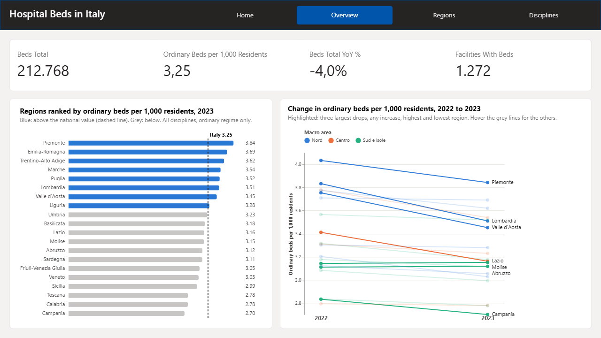
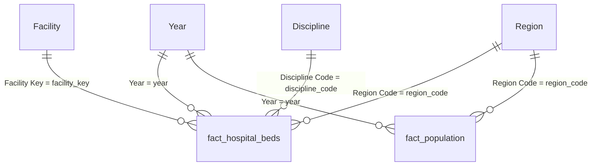
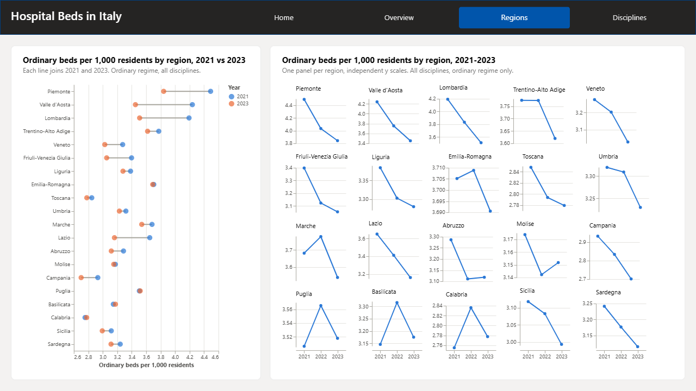
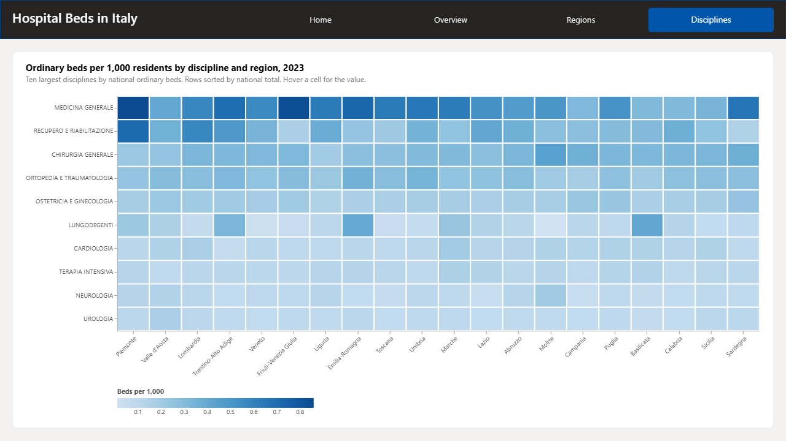

# Hospital beds semantic model

A Power BI semantic model, stored as a **PBIP project with TMDL**, on top of a frozen gold data
contract for Italian hospital beds and resident population. The model is the reusable layer: a clean
star schema, explicit measures that respect the fact that beds and population are *stocks*, row-level
security, and a Best Practice Analyzer check in CI. A four-page report (PBIR) sits on top, with
Deneb (Vega-Lite) charts that come from the companion `deneb-gallery` templates.



## The problem it solves

Public hospital-bed data is easy to get wrong in a report:

- Beds and population are counted on **1 January**. Put a year slicer on three years and a naive sum
  reports three times the beds. Here every stock measure is evaluated at the **latest year in context**.
- "Beds per 1,000 residents" has two meanings. The all-regime figure includes day-hospital and
  day-surgery places; the **ordinary-bed** figure is the one comparable with international statistics.
  Both exist, named so they cannot be confused.
- Beds and population come from different sources and tables. The per-capita measures divide values of
  the **same year and region**, so a slicer cannot produce a mismatched ratio.
- Codes (`010`, `08`, `001272`, `2.1`) are text with leading zeros. They are typed as text in Power Query
  and in the model, and a BPA rule fails the build if a `*_code` column stops being text.

Data contract: `contract/gold_schema.yml` (vendored, read-only, see `contract/VENDORED.md`). Decisions:
`docs/decisions.md` (ADR-010 to ADR-021 are the ones for this repo).

## Model



All relationships are many-to-one, single direction (dimension to fact), active. `Facility` has a
`Region Code` column but **no relationship** to `Region`: the beds fact already carries the region,
and a second path would be ambiguous (ADR-012). A `_Measures` table (no data, one hidden placeholder column) hosts the measures.

| Table | Contract table | Grain | Rows (sample) |
|---|---|---|---|
| `Year` | `dim_year` | year | 3 |
| `Region` | `dim_region` | region or autonomous province | 21 |
| `Discipline` | `dim_discipline` | clinical discipline | 69 |
| `Facility` | `dim_facility` | hospital site | about 1,300 |
| `fact_hospital_beds` | same | year x facility x discipline | about 35,000 |
| `fact_population` | same | year x region | 63 |

**Names (ADR-018).** The four dimensions and their columns carry business names (`Region`, `Region Code`,
`Macro Area`, `Facility Type`...), while each column's `sourceColumn` keeps the contract name, so the CSV
files and the gold contract are unchanged. The two fact tables keep the contract names: all their columns
are hidden, and names such as `Beds Ordinary` belong to the measures.

Keys, foreign keys, sort columns and the numeric fact columns are hidden; every numeric column has
`summarizeBy: none` and `discourageImplicitMeasures` is on, so all numbers come from measures.
`Region`, `Discipline` and `Facility Type` sort by their order or code columns.
`Region` has a `Geography` hierarchy (macro area, geographic area, region).
`Region[ISTAT Region]` gives the 20 ISTAT regions (Bolzano and Trento both in Trentino-Alto Adige, contract
1.1.0); the report charts use it, ordered by the hidden measure `[Region Order]` (ADR-021).

## Measure catalogue

Every measure has a description (TMDL `///`), a format string and a display folder. Beds and population
are stocks at 1 January: **with several years in filter context a measure is evaluated at the latest
year, never summed** (ADR-013). `_year` below is `[Reference Year]`.

| Measure | Folder | What it returns | DAX summary |
|---|---|---|---|
| `Reference Year` | Context | Latest year in the current filter context (MAX of 'Year'[Year]). | `MAX ( 'Year'[Year] )` |
| `Beds Total` | Beds | Active hospital beds on 1 January, all regimes (ordinary, paying, day hospital, day surgery). | `VAR _year = [Reference Year] RETURN CALCULATE ( SUM ( fact_hospital_beds[beds_total] ), 'Year'[Year] = _year )` |
| `Beds Ordinary` | Beds / By Regime | Active beds for ordinary (overnight) inpatient care on 1 January. | `VAR _year = [Reference Year] RETURN CALCULATE ( SUM ( fact_hospital_beds[beds_ordinary] ), 'Year'[Year] = _year )` |
| `Beds Paying` | Beds / By Regime | Active beds for paying ordinary inpatient care in public sites on 1 January. | `VAR _year = [Reference Year] RETURN CALCULATE ( SUM ( fact_hospital_beds[beds_paying] ), 'Year'[Year] = _year )` |
| `Beds Day Hospital` | Beds / By Regime | Active day-hospital (medical day care) beds on 1 January. | `VAR _year = [Reference Year] RETURN CALCULATE ( SUM ( fact_hospital_beds[beds_day_hospital] ), 'Year'[Year] = _year )` |
| `Beds Day Surgery` | Beds / By Regime | Active day-surgery (surgical day care) beds on 1 January. | `VAR _year = [Reference Year] RETURN CALCULATE ( SUM ( fact_hospital_beds[beds_day_surgery] ), 'Year'[Year] = _year )` |
| `Facilities With Beds` | Beds | Number of distinct hospital sites with at least one discipline row on 1 January of the reference year. | `VAR _year = [Reference Year] RETURN CALCULATE ( DISTINCTCOUNT ( fact_hospital_beds[facility_key] ), 'Year'[Year] = _year )` |
| `Resident Population` | Population | Resident population on 1 January (ISTAT, both sexes, all ages). | `VAR _year = [Reference Year] RETURN CALCULATE ( SUM ( fact_population[population] ), 'Year'[Year] = _year )` |
| `Beds per 1,000 Residents` | Per Capita | All-regime beds per 1,000 residents. | `DIVIDE ( [Beds Total], [Resident Population] ) * 1000` |
| `Ordinary Beds per 1,000 Residents` | Per Capita | Ordinary (overnight) beds per 1,000 residents: the ratio to compare with international statistics, which count overnight inpatient beds and leave day-care places out. | `DIVIDE ( [Beds Ordinary], [Resident Population] ) * 1000` |
| `Ordinary Beds per 1,000 Residents (Italy)` | Per Capita | The same ratio for Italy as a whole, ignoring region filters: the national reference next to regional values (bullet and ranked-bar Deneb templates). | `CALCULATE ( [Ordinary Beds per 1,000 Residents], REMOVEFILTERS ( 'Region' ) )` |
| `Beds Total Prior Year` | Change vs Prior Year | All-regime beds on 1 January of the year before the reference year. | `VAR _priorYear = [Reference Year] - 1 RETURN CALCULATE ( [Beds Total], 'Year'[Year] = _priorYear )` |
| `Beds Total YoY Change` | Change vs Prior Year | Absolute year-over-year change in all-regime beds: reference year minus the previous year. | `VAR _current = [Beds Total] VAR _prior = [Beds Total Prior Year] RETURN IF ( NOT ISBLANK ( _current ) && NOT ISBLANK ( _prior ), _current - _prior )` |
| `Beds Total YoY %` | Change vs Prior Year | Year-over-year change in all-regime beds as a percentage of the previous year. | `VAR _change = [Beds Total YoY Change] VAR _prior = [Beds Total Prior Year] RETURN DIVIDE ( _change, _prior )` |
| `Resident Population Prior Year` | Change vs Prior Year | Resident population on 1 January of the year before the reference year. | `VAR _priorYear = [Reference Year] - 1 RETURN CALCULATE ( [Resident Population], 'Year'[Year] = _priorYear )` |
| `Resident Population YoY Change` | Change vs Prior Year | Absolute year-over-year change in resident population: reference year minus the previous year. | `VAR _current = [Resident Population] VAR _prior = [Resident Population Prior Year] RETURN IF ( NOT ISBLANK ( _current ) && NOT ISBLANK ( _prior ), _current - _prior )` |
| `Resident Population YoY %` | Change vs Prior Year | Year-over-year change in resident population as a percentage of the previous year. | `VAR _change = [Resident Population YoY Change] VAR _prior = [Resident Population Prior Year] RETURN DIVIDE ( _change, _prior )` |
| `Ordinary Beds per 1,000 Residents Prior Year` | Change vs Prior Year | Ordinary beds per 1,000 residents on 1 January of the year before the reference year. | `VAR _priorYear = [Reference Year] - 1 RETURN CALCULATE ( [Ordinary Beds per 1,000 Residents], 'Year'[Year] = _priorYear )` |
| `Ordinary Beds per 1,000 Residents YoY Change` | Change vs Prior Year | Absolute year-over-year change in ordinary beds per 1,000 residents (reference year minus previous year). | `VAR _current = [Ordinary Beds per 1,000 Residents] VAR _prior = [Ordinary Beds per 1,000 Residents Prior Year] RETURN IF ( NOT ISBLANK ( _current ) && NOT ISBLANK ( _prior ), _current - _prior )` |
| `Share of National Beds` | Share and Rank | Beds in the current selection as a share of the national total at the same reference year. | `DIVIDE ( [Beds Total], CALCULATE ( [Beds Total], REMOVEFILTERS ( 'Region' ) ) )` |
| `Region Rank by Beds per 1,000` | Share and Rank | Rank of the region by all-regime beds per 1,000 residents. | `IF ( HASONEVALUE ( 'Region'[Region Code] ), RANKX ( ALLSELECTED ( 'Region' ), [Beds per 1,000 Residents], , DESC, DENSE ) )` |
| `Region Rank by Ordinary Beds per 1,000` | Share and Rank | Rank of the region by ordinary beds per 1,000 residents, the internationally comparable ratio. | `IF ( HASONEVALUE ( 'Region'[Region Code] ), RANKX ( ALLSELECTED ( 'Region' ), [Ordinary Beds per 1,000 Residents], , DESC, DENSE ) )` |
| `Ordinary Beds per 1,000 Residents (Top 10 Disciplines)` | Per Capita | The ratio, only for the 10 disciplines with the most ordinary beds nationally; blank for the others. Feeds the discipline heatmap. | `VAR _top = CALCULATETABLE ( TOPN ( 10, VALUES ( 'Discipline'[Discipline] ), CALCULATE ( [Beds Ordinary], REMOVEFILTERS ( 'Region' ) ), DESC ), REMOVEFILTERS ( 'Discipline' ) ) RETURN IF ( SELECTEDVALUE ( 'Discipline'[Discipline] ) IN _top, [Ordinary Beds per 1,000 Residents] )` |
| `Data As Of` | Context | Text for the home page: "Data as of 1 January" and the latest year in the model, whatever the filters. | `VAR _year = CALCULATE ( MAX ( 'Year'[Year] ), REMOVEFILTERS () ) RETURN IF ( NOT ISBLANK ( _year ), "Data as of 1 January " & _year )` |
| `Region Order` (hidden) | Context | Display order of a region in charts grouped by `ISTAT Region`, where the `Sort Order` column would split Trentino-Alto Adige in two rows. | `MIN ( 'Region'[Sort Order] )` |

The Top 10 measure removes **every** filter on `Discipline`, not only the one on its name: a visual that
groups by `Discipline` also groups by its sort-by column `Discipline Code`, and `ALL ( 'Discipline'[Discipline] )`
alone would leave that filter in place and rank each discipline against itself.

Not included on purpose: a calculation group (ADR-017) and a date table (the grain is the year, ADR-019).

## Report

`HospitalBeds.Report` (PBIR) has four 1280 × 720 pages. They share a band with the page title and a page
navigator, and use the theme in `Themes/Hospital Beds Light.json`. The charts are Deneb visuals built from
the `deneb-gallery` templates, so the gallery and the report show the same charts. They plot the 20 ISTAT
regions (`'Region'[ISTAT Region]`, ADR-021) and take title and colours from the spec (ADR-020).

| Page | What it shows | Measures |
|---|---|---|
| Home | The question the report answers, the data date and the way into the other pages | `Data As Of` |
| Overview | KPI card (beds, change on the prior year, hospital sites, ordinary beds per 1,000); regions ranked against the national value; change from 2022 to 2023 per region, with the regions that tell the story highlighted and labelled | `Beds Total`, `Beds Total YoY %`, `Facilities With Beds`, `Ordinary Beds per 1,000 Residents`, `Ordinary Beds per 1,000 Residents (Italy)` |
| Regions | 2021 against 2023 for each region (dumbbell); the 2021-2023 trend, one small panel per region | `Ordinary Beds per 1,000 Residents`, `Region Order` |
| Disciplines | Heatmap of the ten largest disciplines by region, 2023 | `Ordinary Beds per 1,000 Residents (Top 10 Disciplines)`, `Region Order` |

| Regions | Disciplines |
|---|---|
|  |  |

The Overview page is shown at the top of this README; the Home page is in
[`docs/images/report-home.png`](docs/images/report-home.png). Screenshots taken in Power BI Desktop on the
committed sample (2021-2023); number formats follow the locale of the machine that took them.

All the charts use **ordinary** beds per 1,000 residents, the internationally comparable ratio (ADR-014).
The Deneb spec of each chart is stored in its `visual.json`; to change a chart, change the template in
`deneb-gallery` first, then carry the change into the visual, so the two stay the same.

## Open the project in Power BI Desktop

1. Clone the repository. Open **`HospitalBeds.pbip`** in Power BI Desktop (a version with PBIR and TMDL
   support, tested layout from 2.159).
2. **Home > Transform data > Edit parameters**, set **`SampleDataFolder`** to the full path of the
   `sample-data\gold` folder of your clone (no trailing separator needed), for example
   `<your clone>\sample-data\gold`. The committed value is a placeholder on purpose. If you refresh
   before setting it, every table fails with "SampleDataFolder is not set": the hidden query
   `GoldFolder` checks the parameter once for all six tables.
3. **Refresh**. The first refresh creates the local cache; `.pbi/localSettings.json` and `cache.abf` are
   git-ignored and never committed.
4. The report opens on the Home page (see [Report](#report)). Deneb is referenced as a public AppSource
   visual (`publicCustomVisuals` in `report.json`), not packaged with the report: Desktop fetches it when
   the report opens, so the first open needs an internet connection.
5. **Before committing**, put the placeholder back in `SampleDataFolder`. When you press Save, Desktop
   writes the path you set into `expressions.tmdl`, and that path contains your drive and user name.
   The pre-commit hook `sample-data-folder-placeholder` and the CI path check both reject it.

Editing the TMDL files from outside Desktop: save in Desktop first, edit, then choose **Apply external
changes** in Desktop (do not press Save afterwards). See
<https://learn.microsoft.com/power-bi/developer/projects/projects-external-editing>.

## Validate from the command line

Tabular Editor 2 (2.28.0, the version CI pins) loads the TMDL `definition` folder and runs the Best
Practice Analyzer with the rules in `quality/bpa-rules.json`:

```powershell
& "<path to>\TabularEditor.exe" ".\HospitalBeds.SemanticModel\definition" -A ".\quality\bpa-rules.json" | Out-Host
$LASTEXITCODE   # 0 = no error-severity violations; 1 = errors or a TMDL that does not load
```

Add `-V` for Azure DevOps style log lines. TE2 checks TMDL structure and the BPA rules; it does not run
DAX. CI (`.github/workflows/semantic-model-ci.yml`) does the same on `windows-latest` with a pinned,
checksum-verified portable build (ADR-015).

## Alternative source: Databricks SQL warehouse (documented, not implemented)

The gold tables also exist in the lakehouse. To read them from a Databricks SQL warehouse instead of the
CSVs, replace each table's M query with a navigation over the Databricks connector. The connector entry
point is `Databricks.Catalogs` (Azure Databricks) or `DatabricksMultiCloud.Catalogs` (other clouds), with
the server hostname and the warehouse HTTP path
(<https://learn.microsoft.com/power-query/connectors/databricks-azure>):

```powerquery
let
    Source  = Databricks.Catalogs("<workspace-host>", "/sql/1.0/warehouses/<warehouse-id>", [Catalog = null, Database = null]),
    Catalog = Source{[Name = "<catalog>", Kind = "Database"]}[Data],
    Schema  = Catalog{[Name = "gold", Kind = "Schema"]}[Data],
    Table   = Schema{[Name = "dim_year", Kind = "Table"]}[Data]
in
    Table
```

Keep the explicit `Table.TransformColumnTypes` step, keep codes as text, and replace `SampleDataFolder`
with host, HTTP path and catalog parameters. Column names and types are the contract, so the model, the
measures and the RLS role do not change. The navigation shape (`Kind` values) is what Desktop generates
for this connector but was not run against a live workspace here.

## Row-level security

Role **`Region Piemonte`** (`roles/Region Piemonte.tmdl`) is a static example:

```tmdl
role 'Region Piemonte'
	modelPermission: read

	tablePermission Region = 'Region'[Region Code] = "010"

	tablePermission Facility = 'Facility'[Region Code] = "010"
```

**How it propagates.** The filter on `Region` flows down the two single-direction relationships to
`fact_hospital_beds` (by `region_code`) and to `fact_population` (by `region_code`); `Year` and
`Discipline` are untouched. `Facility` is **not** reached from `Region`, so it gets its own
filter, otherwise a member could list the facility names of every region. A consequence: under the role
`Share of National Beds` divides by the beds the user is allowed to see, so it shows 100 percent.

**Test it** in Desktop with **Modeling > View as > Region Piemonte**.

**Making it dynamic.** Add a table `security_user_region (user_principal_name, region_code)` (loaded from
a source the owner maintains, hidden, no relationships), create one role and filter the dimension with
`'Region'[Region Code] IN SELECTCOLUMNS(FILTER(security_user_region, security_user_region[user_principal_name] = USERPRINCIPALNAME()), "r", security_user_region[region_code])`,
and the same expression on `'Facility'[Region Code]`. Members are then assigned to the one role in the
service; access changes by editing the mapping table.

## Quality

`quality/bpa-rules.json` holds 15 Best Practice Analyzer rules written for this model: documentation
(tables, measures, visible columns, display folders, format strings), modelling (numeric columns do not
summarize, `*_code` columns are text, hidden foreign keys, no bidirectional, many-to-many or inactive
relationships, implicit measures discouraged) and DAX (no `IFERROR`). Errors fail CI, warnings do not.

## Trade-offs

- **Latest year in context** is a convention. It is documented per measure and `Reference Year` shows
  it, but a user who wants a multi-year average has to build it.
- **Ordinary beds exclude paying beds.** If the contract owner counts paying beds as overnight beds the
  ratio changes slightly (ADR-014).
- **No facility-to-region relationship** keeps the star unambiguous but means facility attributes do not
  filter population; the facility-level per-capita view divides by regional population.
- **Static RLS** is simple to review and test; the dynamic version needs a maintained mapping table.
- **Sorting** of `macro_area` and `geographic_area` is alphabetical (the contract has no order column
  for them).
- DAX was not executed by an engine in CI: BPA checks structure and metadata, so measure results are
  verified in Desktop.

## Data attribution

The CSVs in `sample-data/gold/` are derived from data published by the **Ministero della Salute**
(Italian Ministry of Health) under the
[Italian Open Data License v2.0](https://www.dati.gov.it/iodl/2.0/) and by **ISTAT** under
[CC BY 4.0](https://creativecommons.org/licenses/by/4.0/). The data has been cleaned, re-keyed and
aggregated; neither publisher endorses this project. See `contract/VENDORED.md`.

## License

Code and documentation: MIT (`LICENSE`). The sample data keeps the licenses above.
